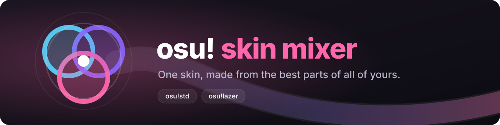

<p align="center">
  
</p>

Make a new osu!lazer skin by picking parts from skins you already have.

It works with osu!lazer, the osu! (standard) game mode, and skins made of image and sound files.


## How to use it

1. Download the file for your system from the Releases page and run it. There is nothing to install.
2. Type a name for your skin and choose a skin to start from.
3. Change what you like
4. Click **Create skin**. Your skin now shows up in osu!'s skin list.
5. After more changes, click **Apply**. In osu!, switch to another skin and back to see them.

## Options

You don't need any of these for normal use.

| Option | What it does |
| --- | --- |
| `--no-open` | Doesn't open a window. Keeps running until you stop it. |
| `--browser` | Opens in your browser instead of its own window. |
| `OSU_DIR` | Environment variable. The folder osu! keeps its data in. |
| `MIXER_STATE_DIR` | Environment variable. The folder the mixer keeps its own data in. |
| `PORT` | Environment variable. The port to use. The default is 5727. |

Where things are kept:

| | Linux | Windows |
| --- | --- | --- |
| osu!'s data | `~/.local/share/osu` | `%APPDATA%\osu` |
| The mixer's data | `~/.local/share/osu-skin-mixer` | `%LOCALAPPDATA%\osu-skin-mixer` |

## Development

For tinkering with the code. You need the .NET 10 SDK and Node 22. With Nix, `nix develop` gives you both, and the scripts below use it
by themselves.

```sh
./run        # start it at http://127.0.0.1:5727 without opening a window
./publish    # build the Linux and Windows files into dist/
```

- `server/` reads and writes osu!'s database (C#).
- `web/` is the interface and the preview (TypeScript, React, PixiJS).
- In `web/`, `npm run dev` gives live reloading on port 5728 while `./run` is running, and `npm test` runs
  the tests.
- The Realm package in `server/server.csproj` has to be the same version osu!lazer uses, or the database
  won't open.

## Limits

- The preview is close to the game but not identical. Sliders appear all at once instead of snaking in, and
  beatmap skins, storyboards and a beatmap's own hit sounds are not used.
- Applying has only been tested with osu! closed. If Apply fails, close osu! and try again.
- The Windows version has not been tested on Windows yet.
- The first time you run it, it downloads osu!'s built-in skin so it can show default elements. That needs
  an internet connection once.
- Only osu! (standard) is previewed. Elements for other modes can be mixed but not seen.
