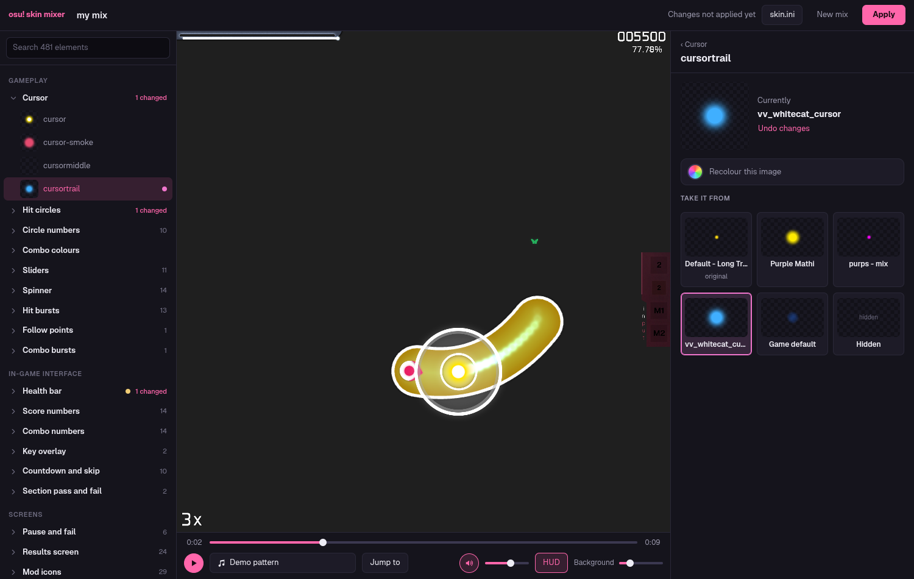

<p align="center">
  
</p>

Make a new osu!lazer skin by picking parts from skins you already have.

It works with osu!lazer, the osu! (standard) game mode.



## How to use it

1. Download the app for your system and open it. There is nothing else to install.
   - [Linux](https://github.com/Pvrps/osu-skin-mixer/releases/latest/download/osu-skin-mixer-linux.AppImage)
   - [Windows](https://github.com/Pvrps/osu-skin-mixer/releases/latest/download/osu-skin-mixer-windows.exe)
   - [macOS](https://github.com/Pvrps/osu-skin-mixer/releases/latest/download/osu-skin-mixer-macos.dmg)

   Older versions are on the [releases page](https://github.com/Pvrps/osu-skin-mixer/releases).
2. Type a name for your skin and choose a skin to start from.
3. Change what you like. **Edit image** on any element opens an editor for drawing on it, erasing parts of it and changing its colours.
4. Click **Create skin**. Your skin now shows up in osu!'s skin list.
5. After more changes, click **Apply**. Refresh the skin in osu! to see them.

When a newer version is out, the mixer says so at the top of its window, with a link to download it.

## Options

You don't need any of these for normal use.

| Option | What it does |
| --- | --- |
| `OSU_DIR` | Environment variable. The folder osu! keeps its data in. |
| `MIXER_STATE_DIR` | Environment variable. The folder the mixer keeps its own data in. |
| `MIXER_NO_UPDATE_CHECK` | Environment variable. Set to `1` to stop the mixer asking GitHub whether a newer version is out. |

Where things are kept:

| | Linux | Windows |
| --- | --- | --- |
| osu!'s data | `~/.local/share/osu` | `%APPDATA%\osu` |
| The mixer's data | `~/.local/share/osu-skin-mixer` | `%LOCALAPPDATA%\osu-skin-mixer` |

## Development

For tinkering with the code. You need the .NET 10 SDK and Node 22. With [devenv](https://devenv.sh),
`devenv shell` gives you both (and Electron), and the recipes below use it by themselves. They are run with
[just](https://just.systems).

```sh
just dev      # serve it at http://127.0.0.1:5727, to open in a browser
just app      # build and open the app itself
just build    # build the app for the system you're on into dist/
just test     # run the interface's tests
just check    # type check the interface
```

- `app/` is the window (Electron). It starts the server and shows the page it serves.
- `server/` reads and writes osu!'s database (C#).
- `web/` is the interface and the preview (TypeScript, React, PixiJS).
- Code that differs between Linux and Windows is kept apart in `app/src/platform/` and `server/Platforms/`, one file per system.
- In `web/`, `npm run dev` gives live reloading on port 5728 while `just dev` is running.
- The Realm package in `server/server.csproj` has to be the same version osu!lazer uses, or the database
  won't open.

## Limits

- The preview is close to the game but not identical.
- The macOS version has not been tested yet.
- The macOS version only runs on Macs with an Apple chip (M1 or newer), not older Intel ones.
- The first time you run it, it downloads osu!'s built-in skin so it can show default elements. That needs
  an internet connection once.
- Only osu! (standard) is previewed. Elements for other modes can be mixed but not seen.
